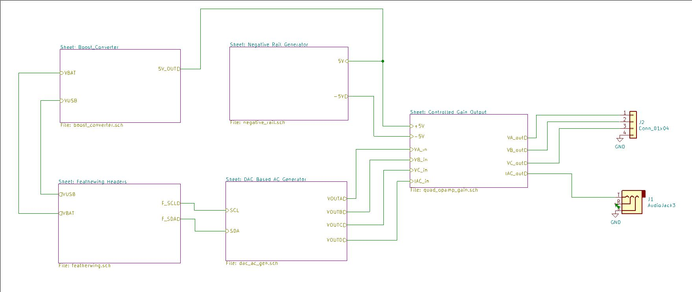

# 3-Phase ELV synthesizer using DAC and Opamps

This is a FeatherWing ideally used with Teensy 3.2/4.0 to drive a high-speed DAC with 
filtering and signal conditioning using Opamps.

## KiCad 10 design

Revision **v0.4 (2026-10-28)** is maintained in
`Tph_Synth_Featherwing\Tph_Synth_Featherwing.kicad_pro`. Open that project and
its root schematic rather than treating the hierarchical sheets as separate
projects. The revision is also printed on the PCB bottom silkscreen.

The project-local symbol and footprint tables resolve the converted libraries,
board-edge silkscreen variants and existing `3dmodels` assets. Keep these
directories together with the project and install the standard KiCad 10
symbol, footprint and 3D-model libraries.

From the repository root, validate with KiCad 10's `kicad-cli` on `PATH`:

```powershell
kicad-cli sch erc .\Tph_Synth_Featherwing\Tph_Synth_Featherwing.kicad_sch --severity-all --exit-code-violations
kicad-cli pcb drc .\Tph_Synth_Featherwing\Tph_Synth_Featherwing.kicad_pcb --severity-all --schematic-parity --exit-code-violations
```

Both checks pass with zero violations, unconnected items or schematic-parity
mismatches. All 515 existing tracks/vias and component placement are preserved.
The Default and Power netclasses use 0.15 mm clearance; silkscreen-edge checking
is enabled. See [the v0.4 schematic](doc/v0.4/schematic.pdf) and
[top](doc/v0.4/board-top.png)/[bottom](doc/v0.4/board-bottom.png) renders and a
[populated STEP turntable](doc/v0.4/board-turntable.mp4) (Feather headers are
DNP and not shown). Recreate it by exporting a populated STEP with
`kicad-cli pcb export step --subst-models --include-tracks --include-pads
--include-silkscreen --include-soldermask`, converting it to GLB with the
`cascadio` Python package, then running
`blender -b --factory-startup -P scripts/render_turntable.py -- board.glb out.mp4 150 anim`.
The exact R10 PV36W STEP was unavailable, so R10 uses the generic 3296W model.
These are visualisations, not mechanical fit certification.
These CAD checks do not replace hardware/firmware and analog-output testing.

## Manufacturing preparation

The current preparation is in `manufacturing\v0.4`. **Assembly and purchasing
are on hold**, even though the CAD checks pass. Use the freshly generated
fabrication ZIP there, not the historical `Tph_Synth_Featherwing\gerbers`,
`bom` spreadsheet or iBOM. The archive has copper, mask, silkscreen, paste and
outline Gerbers plus separate PTH/NPTH drills. The nominal outline is
51 x 58.5 mm, two copper layers, 1.6 mm board thickness. Confirm material,
copper weight, surface finish, quantity and panelization with the fabricator;
none has been ordered.

Generate a new package into an empty directory using KiCad's bundled Python:

```powershell
& 'C:\Program Files\KiCad\10.0\bin\python.exe' .\scripts\prepare_manufacture.py --output .\manufacturing\v0.4-new
```

The exporter requires zero ERC, DRC, unconnected and parity findings. It derives
the BOM from schematic fields, checks SMT placements against that BOM and
records input/output SHA-256 hashes in `manifest.json`. Regenerate into a new
directory if the destination is already populated; it deliberately refuses to
mix old and new exports. `release-status.json` records every sourcing review
and release action. Positions are in millimetres using the absolute CAD origin
for Gerbers, drills and placements; bottom X is not negated. Have the assembler
verify rotations, polarity and panel tooling. THT parts are listed separately
from the SMT position file.

For [issue #3](https://github.com/whatnick/Tph_Synth_Featherwing/issues/3),
SDA, SCL, 3V3, GND, VUSB and VBAT are labelled at the Feather header pads on
both PCB sides. Back-side labels are mirrored for correct fabrication.
Silkscreen checks enforce 0.15 mm clearance; test-pad references and the U4
reference are positioned clear of other markings. Run the tests with KiCad's
bundled Python to include the PCB pin-label and silkscreen-rule checks:

```powershell
& 'C:\Program Files\KiCad\10.0\bin\python.exe' -m unittest discover -s tests -v
```

Initial legacy sourcing evidence is in `sourcing\distributor-review-2026-11-07.json`
and copied into the manufacturing package. All 21 unique legacy fitted MPNs (46 parts,
22 BOM rows) were checked in three Mouser MCP batches; DigiKey was used for
four targeted blocker/candidate lookups. Results were matched by **MPN and
manufacturer**, excluding an unrelated obsolete ROHM `LM324PWR` result.
Prices are indicative USD single-unit observations, not a quotation or landed
cost. Null Mouser lifecycle means "not stated", not "Active".

The user-approved breakout replacements are now applied to the schematic,
PCB and review BOM, including legacy `manf#` fields:

| References | Selected MPN | Ratings/package | Stocked source observed 2026-11-07 |
|---|---|---|---|
| C1-C3 | TDK `C2012X5R1V226MT000E` | 22 uF, +/-20%, 35 V, X5R, 0805 | LCSC/JLCPCB `C338080`: 56,013 |
| C4-C11/C18 | Murata `GRM21BR61H106KE43L` | 10 uF, +/-10%, 50 V, X5R, 0805 | Mouser `81-GRM21BR61H106KE3L`: 2,564; JLCPCB `C440198`: 1,065,869 |
| C12 | YAGEO `CC0603BRNPO9BN5R0` | 5 pF, +/-0.1 pF, 50 V, C0G, 0603 | Mouser `603-CC603BRNPO9BN5R0`: 2,442 |

See `sourcing\distributor-review-substitutions-2026-11-07.json` for approval,
voltage rationale and current choices; the earlier review and alternative
records are historical. No voltage rating is reduced. The intended VBAT/5 V
and +/-5 V circuits are below these ratings; external overvoltage and fault
transients have not been qualified. Copper, placement and footprint geometry
are unchanged.

Remaining release checks:

- **Capacitor performance:** the 22 uF dielectric changes from JB to X5R.
  Check effective capacitance under DC bias/temperature, boost and charge-pump
  startup/ripple/stability, and 5 pF compensation on hardware. Murata's reference
  sheet is headed General Purpose, while DigiKey labels its application Mobile
  Devices Only; use is approved for this breakout, not unrestricted production.
  Keep the manufacturer application/height checks on the release checklist.
- **Supply/packing:** the TDK exact MPN is sourced through LCSC/JLCPCB, not
  presently orderable at Mouser or DigiKey. Recheck inventory before purchase.
  Observed Mouser stock of the replacements is below one full reel; verify
  packaging with the assembler and supplier rather than assuming reel supply.
- **R10:** verify `PV36W202C01B00` body/lead geometry, pin numbering and adjustment
  access against the Bourns 3296W footprint. This is an unverified fit, not a
  demonstrated mismatch: the PCB has three collinear holes on 2.54 mm centres,
  0.8 mm drills; pins 1/2 are connected and pin 3 is unused.
  The supplied `doc/pv36.pdf` now confirms inline pitch/pin order and pin 2
  as wiper, but recommends 0.9 mm holes rather than the PCB's 0.8 mm.
  Nominal lead diameter is 0.51 +/-0.03 mm; check finished-hole tolerances
  and insertion. R10's 3296W 3D model remains a proxy, not a verified PV36W.
- **Panel-pot CAD:** R7/R8/R9/RV1 use the Bourns PTV09A-2X20F family STEP.
  Corrected its model X offset from 3.5 to 3.1 mm to align signal leads.
  All lead/tab sections fit nominal holes at board midplane, but about
  0.331 mm3 model/board intersection remains per pot near mounting features;
  verify physical seating. See `sourcing\distributor-review-pot-fit-2026-11-07.json`
  for measurements, provenance and exact-MPN model-search limitations.
- **Host interface:** Adafruit
  [3200](https://www.adafruit.com/product/3200) is an external Teensy-to-Feather
  adapter, not a component fitted at MS1. It is listed separately from the PCB
  assembly BOM. **DNP the Feather host 12-pin/16-pin headers during
  manufacture.** Users fit compatible stacking headers later to suit their
  Feather; factory header selection/stacking height is not a release blocker.
  This policy applies only to the host rows, not fitted J2/J3 connectors.
  Headers and the Teensy are excluded from factory purchasing.
- **Production quantity/packaging:** R11-R14 consume four precision resistors
  per board; the 163 units observed at Mouser cover at most 40 boards before
  spares. U4 `MCP4728-E/UN` is supplied in tubes; assembler acceptance or a
  qualified reel suffix is still required.
- All other legacy MPNs still require datasheet electrical/mechanical
  qualification and a fresh stock, packaging, price and lifecycle check before
  ordering. Bench-test power rails, I2C/DAC, analog outputs and
  the Howland current source before a production release.

`Manufacturer`, `MPN`, `Description`, `DigiKey`, `Mouser`, `Assembly`,
`SourcingStatus` and `SourcingNotes` live on the schematic symbols and are
mirrored to the PCB for parity. `DigiKey` and `Mouser` remain **search URLs**.
Separate `MouserOrderCode`, `DigiKeyOrderCode`, `LCSCOrderCode` and `DistributorChecked` fields
carry dated, exact-manufacturer MCP observations; blank DigiKey codes mean
that MPN was not checked there. These codes do not override a sourcing hold.

The harness now connects to the public **pcbparts** MCP at
`https://pcbparts.dev/mcp`. `mouser_get_part` batches up to 10 part lookups;
`digikey_get_part` checks one MPN/order code at a time. Parametric catalog
search is provided by `jlc_search`, not the distributor lookup tools.
The hosted service shares a 1,000-request/day quota per distributor; do not
retry quota errors or check the whole BOM repeatedly in DigiKey. No API keys
are needed for this hosted endpoint. Self-hosting requires your own
[DigiKey developer API](https://developer.digikey.com/) and
[Mouser Search API](https://www.mouser.com/api-search/) credentials to enable
their lookups. Keep credentials outside the repository.

## Features :
- 50/60 Hz Frequency Selector ( Possibly just do it in software).
- Pot driven voltage Setting by controlling inverting-Opamp gain.
- Modified-Howland current source to simulate current clamp output.
- Pot driven current source using a tapped potentiometer attached to DAC output.
- ±5v RMS output using dual-rail Opamp mode - [OPA4170AIPW](https://au.element14.com/texas-instruments/opa4170aipw/op-amp-quad-rro-1mhz-14tssop/dp/2095843) or [LM324PWR](https://au.element14.com/texas-instruments/lm324pwr/ic-op-amp-1-2mhz-0-5v-us-tssop/dp/2342289)
- Dual-voltage rail generation using [LM2663](https://au.element14.com/texas-instruments/lm2663mx-nopb/dc-dc-charge-pump-inverting-soic/dp/3008264) to flip 5v input to -5v.
- Boost-converter to push battery voltage (4.2v-3.7v) to 5v for non-USB power mode using [PAM2401](https://au.mouser.com/datasheet/2/115/PAM2401-347378.pdf).
- I2C DAC circuit to generate plausible phase shifted sine-wave, like in my [DIYODE 
Article](https://diyodemag.com/features/safe_3-phase_generator) using [MCP4728](https://au.element14.com/microchip/mcp4728-e-un/ic-dac-12bit-quad-10msop/dp/1800217).
- Fully open-source schematic/pcb in KiCAD.



## Roadmap Features :
- Experiment with power Opamps or eBay power amplifiers to output real 240v rail-to-rail swings.
- Experiment with power path IC's to manage supply from USB vs Battery. Particulary [LTC4412](https://www.analog.com/media/en/technical-documentation/data-sheets/4412fb.pdf) is of interest at high-power modes due to losses in [Schottky diodes](https://www.analog.com/media/en/technical-documentation/product-information/Battery_Management_Soulutions_PowerPath.pdf) and LV usage with buck-converters from 240v.
- Add I2C digital pots instead of physical pots.
